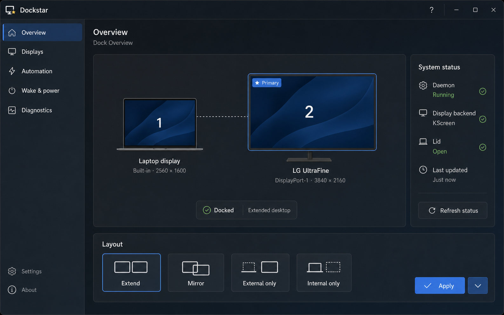
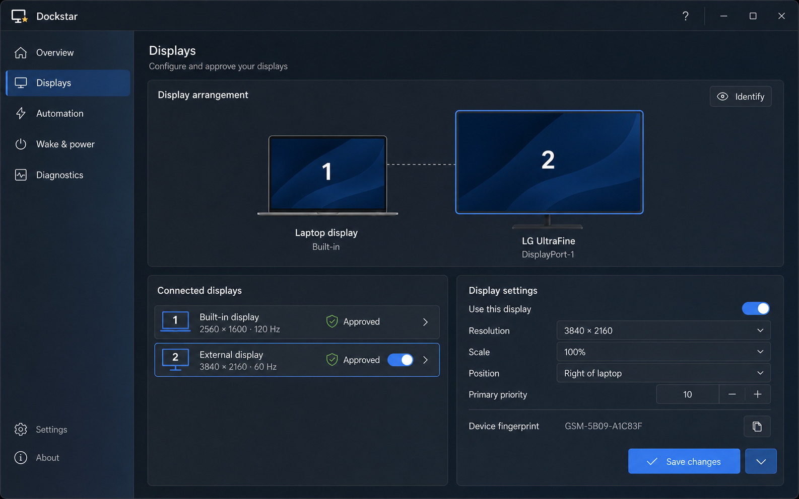
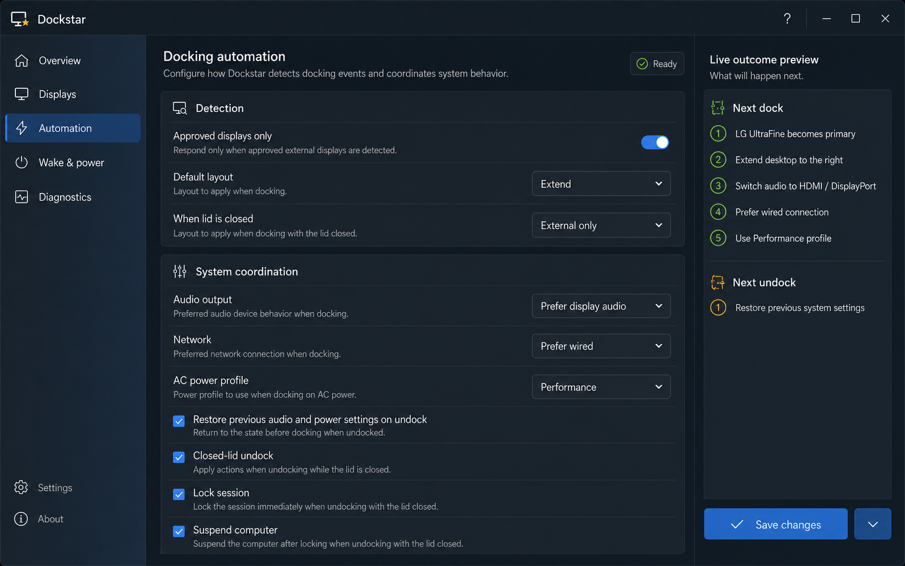

# Dockstar UI mockups

These concepts translate the strongest parts of ThemeTime's Solar Observatory
interface into Dockstar's display-management workflow. They share one visual
system and represent connected product screens rather than unrelated themes.

The reference was the sibling [`themetime`](../../../themetime) project,
especially its compact KDE navigation, dominant visual workspace, contextual
status inspector, restrained use of color, and clear separation between daily
status and detailed editing.

## Dock overview

The overview answers the three questions that matter immediately after docking:

1. Did Dockstar recognize the dock?
2. Which display is primary and how are the screens arranged?
3. Which layout will be applied?

The display topology replaces the current text-only status tab. Layout choices
use visual radio tiles because users should be able to distinguish extend,
mirror, and single-display modes without decoding configuration values.

## Displays workbench

The displays screen combines device trust and per-display configuration. The
arrangement remains visible while the selected display's resolution, scale,
position, priority, and fingerprint are edited.

Device approval is prominent for external displays and visibly fixed for the
built-in panel. The EDID fingerprint remains available for verification without
competing with the human-readable display name.

## Docking automation

Automation settings are grouped by intent instead of exposing raw configuration
vocabulary. A live outcome preview translates the selected policies into the
sequence Dockstar will perform on the next dock and undock.

The preview is especially useful for combinations such as external-only mode,
display audio, wired networking, power-profile changes, and closed-lid safety
actions.

## Shared design language

- Use the Dockstar monitor-and-star mark as the product identity.
- Keep global navigation stable and compact on the left.
- Use blue for selection and primary actions, yellow for the Dockstar accent,
  green for confirmed health, and red only for actionable failures.
- Keep content surfaces opaque; translucency belongs only in window chrome and
  navigation.
- Prefer separators and aligned rows over a wall of nested cards.
- Use familiar icons for refresh, identify, copy, and help, with tooltips.
- Keep controls at desktop utility density with 6-8 px corner radii.
- Preserve a clear keyboard focus ring and at least WCAG AA text contrast.

## Relationship to the current code

Most content maps directly to the current daemon and configuration model:

| Mockup concept | Current source |
| --- | --- |
| Docked state, backend, primary, outputs, lid, update time | `daemon.State` |
| Extend, mirror, external-only, and internal-only | Layout configuration and `SetLayout` |
| Device approval and fingerprint | `display.Output` and `ApproveDisplay` |
| Resolution, scale, position, and primary priority | `config.DisplayRule` |
| Detection, closed-lid layout, audio, network, and power | `config.Config` |
| Lock and suspend on closed-lid undock | `config.Security` |
| Apply and save | Existing D-Bus methods |

Several interactions would need implementation before the mockups can become
the production UI:

- graphical drag-to-arrange and display identification;
- editors for mode, scale, position, and primary rank;
- an explicit enable/disable-display operation;
- a computed dock/undock outcome preview;
- live status updates instead of the current manual refresh path;
- separate or clearly combined controls for audio and power restoration.

These are deliberately called out so visual design does not silently become an
API promise.

## Recommended implementation order

1. Build the shared window shell, navigation, status header, and reusable form
   rows.
2. Replace the current status tab with Dock Overview using existing D-Bus data.
3. Add the Displays list and approval flow, then expose the existing display
   rule fields.
4. Move the current automation form into the new grouped layout.
5. Add the outcome preview after policy evaluation has a reusable read-only API.
6. Finish Wake & power and Diagnostics in the same shell.

The exact generation specifications are recorded in [PROMPTS.md](PROMPTS.md).
