```mermaid
stateDiagram-v2
    [*] --> Snapshot
    Snapshot --> Unchanged: same devices, approvals, and lid
    Snapshot --> Pending: unknown external outputs
    Pending --> Snapshot: emit PendingDisplay
    Snapshot --> Docked: approved external exists and detection is active
    Snapshot --> Undocked: no approved external or detection is off
    Docked --> Docked: apply selected layout and dock actions
    Docked --> Undocked: restore actions; optionally lock and suspend
    Undocked --> Docked: new approved external
```

# Architecture

## Design goals

Dockstar keeps display automation available without tying it to a window,
isolates KDE-specific display code behind a backend, and gives the small amount
of privileged code a narrow fixed interface.

The main ownership rules are:

- Only the daemon owns mutable desktop state and configuration writes.
- The CLI, tray, and settings window are D-Bus clients.
- Display enumeration and layout application live behind `display.Backend`.
- Only `dockstar-wake-helper` writes privileged system state.
- Configuration and D-Bus payloads are versioned or revision checked.

## Process model

```mermaid
flowchart LR
    UI[dockstar-ui Wails window and tray] -->|session D-Bus| Daemon[dockstar daemon]
    CLI[dockstar CLI] -->|session D-Bus| Daemon
    Daemon --> Config[config.json]
    Daemon --> KScreen[kscreen-doctor]
    Daemon --> KWin[KWin Wayland protocols]
    Daemon --> Desktop[PowerDevil, logind, Pulse, NetworkManager, power profiles]
    CLI -->|pkexec| Helper[dockstar-wake-helper]
    UI -->|dockstar wake| Helper
    Helper --> Sysfs[PCI power/wakeup]
    Helper --> WakePolicy[/etc and /var/lib wake JSON]
```

### `dockstar daemon`

The daemon opens the config store, creates the KScreen backend, claims the
session bus name, and runs the controller loop. It is normally managed by
`dockstar.service` with `Type=dbus` and can be activated by the D-Bus service
file.

### `dockstar-ui`

The UI embeds a Wails frontend and runs the system tray through systray's
external event loop. Without arguments it starts with the window hidden; with
`--settings` it starts visible. A single-instance lock routes later launches to
the existing process and shows its window. Closing the window hides it, while
Quit from the tray ends the UI process. The daemon remains independent in all
cases.

The Go adapter in `cmd/dockstar-ui` exposes typed state, configuration, apply,
approval, wake, and diagnostic methods to JavaScript. Each operation remains a
D-Bus call to the daemon. The frontend under `cmd/dockstar-ui/frontend` owns
rendering, draft state, navigation, outcome previews, and responsive layout;
it never writes the configuration file directly.

### `dockstar-wake-helper`

The helper has no D-Bus or display responsibilities. It validates one fixed
action, discovers eligible PCI devices, and reads or writes only Dockstar policy
files and derived sysfs wake paths.

## Daemon state machine

The controller evaluates once at startup, every two seconds, and after resume.
Resume events come from logind `PrepareForSleep(false)` and are delayed 750 ms
to let KWin and DRM settle.



The debounce signature contains each connected output's Dockstar ID and
approval boolean plus the lid state. It intentionally does not include every
mode or geometry field. `Apply`, layout changes, config changes, and resume can
force evaluation despite an unchanged signature.

## Evaluation flow

1. Load an immutable config copy from the store.
2. Query `kscreen-doctor -j` and translate outputs into `display.Snapshot`.
3. Query PowerDevil for lid state.
4. Skip an unchanged signature unless forced.
5. Separate approved and pending external outputs.
6. Emit `PendingDisplay` for each pending output.
7. Determine docked state and choose the normal or closed-lid layout.
8. Request DPMS on, then apply the display transaction.
9. On a new dock or forced apply, run platform dock actions.
10. On undock, restore platform actions and optionally lock and suspend.
11. Write runtime state and emit `StateChanged`.

Display transaction failures update `lastError`, persist runtime state, emit
`ApplyFailed`, and prevent dock actions for that evaluation.

## Configuration store

`internal/config` owns schema types, defaults, validation, cloning, and atomic
storage. The store uses an `RWMutex` and returns copies so callers cannot mutate
shared slices.

There are two update paths:

- `Replace` accepts a complete config and expected revision for UI/D-Bus
  optimistic concurrency.
- `Update` runs a callback under the write lock for convenience operations such
  as allow, deny, trust, and mode.

Both validate before writing and increment the revision. `Reload` validates an
externally edited file before replacing in-memory state.

## Display backend

The public contract in `internal/display/display.go` has four methods:

```go
type Backend interface {
    Snapshot(context.Context, config.Config) (Snapshot, error)
    Apply(context.Context, config.Config, string) (ApplyResult, error)
    DPMSOn(context.Context) error
    Name() string
}
```

This boundary is the intended extension point for a future compositor backend.
The daemon does not depend on KScreen JSON types or Wayland protocol objects.

### Discovery

`KScreen.Snapshot` runs `kscreen-doctor -j`, decodes its output, identifies
internal panels, derives device IDs, attaches approval and labels from config,
and normalizes advertised modes.

The command runner is an interface, allowing tests to inspect complete atomic
transactions without changing the real display.

### Non-mirror layouts

Extend, external-only, and internal-only are expressed as one
`kscreen-doctor` invocation. Every setting is passed in the same process so
KScreen applies the requested changes atomically.

### Mirror layout

KScreen JSON exposes `replicationSource`, but its CLI does not set replication.
`internal/display/wayland_mirror.go` therefore uses `wlcl` and checked-in
generated bindings to:

1. Bind KDE output management and device registry globals at the minimum of
   server and supported protocol versions.
2. Round-trip until devices, UUIDs, and modes are known.
3. Match KScreen connectors to KDE device objects.
4. Select corresponding mode objects.
5. Create a single output configuration, set mode, position, scale, priority,
   enabled state, and replication source, then apply.
6. Dispatch until KWin reports applied, failed, or a failure reason.

KDE documents this protocol as an implementation detail. Keeping it behind the
backend limits the impact of protocol changes.

## Platform actions

`internal/platform.Manager` serializes dock and undock actions with a mutex. It
records only values Dockstar may need to restore:

- Previous default audio sink.
- Previous power profile.
- Ethernet device connected by Dockstar.
- Whether Dockstar disabled Wi-Fi.

Command paths are fixed and arguments are constructed from validated config or
parsed command output. Each child command receives a 15-second context.

Lid, lock, and suspend operations use D-Bus instead of shell commands.

## D-Bus layer

`internal/ipc.Server` exports a narrow `Handler` interface implemented by the
controller. It translates Go errors to D-Bus errors and owns introspection XML
and signal emission. `internal/ipc.Client` is a small typed wrapper used by the
CLI and UI.

JSON strings carry evolving structured status and config data while D-Bus
method signatures remain small. Config revision is a separate unsigned 64-bit
argument and return value.

## Runtime files

| Path | Owner | Purpose |
| --- | --- | --- |
| `$XDG_CONFIG_HOME/dockstar/config.json` | user daemon and clients | Persistent validated config |
| `$XDG_RUNTIME_DIR/dockstar/state.json` | daemon | Latest runtime state snapshot |
| `/etc/dockstar/wake.json` | root helper | Persistent desired wake state and managed IDs |
| `/var/lib/dockstar/wake-baseline.json` | root helper | First-recorded source states for restore |

Runtime state is a convenience mirror of `GetStatus`; D-Bus is the live source
of truth.

## Security model

The primary daemon, CLI, and UI run as the desktop user. Their effects are
limited to the user's display session and commands already authorized for that
user.

The Polkit policy names only `/usr/bin/dockstar-wake-helper`. The helper rejects
unknown operations and validates PCI IDs and state values before deriving
paths. It never accepts an arbitrary path from an unprivileged caller.

See [Hardware Wake](wake.md#privilege-boundary) and
[SECURITY.md](../SECURITY.md) for the operational boundary.

## Failure behavior

- Invalid config prevents daemon startup or reload; the existing in-memory
  config remains intact on a failed reload.
- Failure to query KScreen updates `lastError` and leaves the current layout
  untouched.
- Display apply failure skips platform dock actions.
- Individual platform action failures are joined, logged as warnings, and do
  not roll back a successful display layout.
- Failure to query lid state is logged at debug level and treated as open.
- A missing wake policy makes the post-resume helper fail harmlessly because
  the sleep hook ignores its exit status.
