# Architecture

## Design goals

Dockstar keeps display automation available without tying it to a window,
isolates KDE-specific display code behind a backend, and gives the small amount
of privileged code a narrow fixed interface.

The main ownership rules are:

- Only the daemon owns mutable desktop state and configuration writes.
- The CLI, tray, and settings window are D-Bus clients.
- Display enumeration and layout application live behind `display.Backend`.
- Only the fixed wake and startup helpers write privileged system state.
- Configuration and D-Bus payloads are versioned or revision checked.

## Process model

```mermaid
flowchart LR
    UI[dockstar-ui Wails window and tray] -->|session D-Bus| Daemon[dockstar daemon]
    CLI[dockstar CLI] -->|session D-Bus| Daemon
    Daemon --> Config[config.json]
    Daemon --> KScreen[kscreen-doctor]
    Daemon --> KWin[KWin Wayland protocols]
    Daemon --> Desktop[PowerDevil, logind, Pulse, NetworkManager, power profiles]
    CLI -->|pkexec| Helper[dockstar-wake-helper]
    UI -->|dockstar wake| Helper
    Helper --> Sysfs[PCI power/wakeup]
    Helper --> WakePolicy[/etc and /var/lib wake JSON]
```

### `dockstar daemon`

The daemon opens the config store, creates the KScreen backend, claims the
session bus name, and runs the controller loop. It is normally managed by
`dockstar.service` with `Type=dbus` and can be activated by the D-Bus service
file.

### `dockstar-ui`

The UI embeds a Wails frontend and runs the system tray through systray's
external event loop. Without arguments it starts with the window hidden; with
`--settings` it starts visible. A single-instance lock routes later launches to
the existing process and shows its window. Closing the window hides it, while
Quit from the tray ends the UI process. The daemon remains independent in all
cases.

The Go adapter in `cmd/dockstar-ui` exposes typed state, configuration, apply,
approval, suspend, wake, and diagnostic methods to JavaScript. Each operation
remains a D-Bus call to the daemon. The frontend under
`cmd/dockstar-ui/frontend` owns rendering, draft state, navigation, outcome
previews, and responsive layout; it never writes the configuration file
directly.

### `dockstar-wake-helper`

The helper has no D-Bus or display responsibilities. It validates one fixed
action, discovers eligible PCI controllers and USB root hubs, and reads or
writes only Dockstar policy files and derived sysfs wake paths.

### Pre-login protection

`dockstar startup-guard` runs in the hardened system
`dockstar-startup.service`, before the display manager. It reads physical DRM
connections and a root-owned allowlist without a user bus, compositor, or home
directory. Only an enrolled external EDID can acquire its lease. Policy,
hardware, or logind query errors release protection.

`dockstar-startup-helper` accepts enable/disable through Polkit. Enable snapshots
explicit user approvals into `/var/lib/dockstar/startup.json` and enables the
system unit. Changes to session approvals do not silently mutate boot policy;
authenticated re-enrollment replaces the list. The guard hands off whenever a
local graphical user session exists, including a locked session, so it cannot
block the session daemon's intentional suspend path.

## Daemon state machine

The controller evaluates once at startup, every two seconds, and after resume.
Sleep and resume events come from logind `PrepareForSleep`. After resume, the
daemon starts a bounded guard when the pre-sleep state was docked or lid-closed,
or when hardware wake is enabled. It polls for up to 30 seconds while KWin and
DRM rediscover the dock, with an early release for an open-lid undocked state.

```mermaid
stateDiagram-v2
    [*] --> Snapshot
    Snapshot --> Unchanged: same devices, approvals, and lid
    Snapshot --> Pending: unknown external outputs
    Pending --> Snapshot: emit PendingDisplay
    Snapshot --> Docked: approved external exists and detection is active
    Snapshot --> Undocked: no approved external or detection is off
    Docked --> Docked: apply selected layout and dock actions
    Docked --> Undocked: restore actions; optionally lock and suspend
    Undocked --> Docked: new approved external
```



The debounce signature contains both compositor and physical connected-output
IDs and approvals, plus lid state. It intentionally excludes mode and geometry.
The signature is committed only after successful layout processing, so failed
transactions retry. `Apply`, layout changes, config changes, and resume can
force evaluation despite an unchanged signature. Physical safety transitions,
published dock state, and applied platform-action state are separate, preserving
security and pending restorations across discovery/apply failures.

## Evaluation flow

1. Load an immutable config copy from the store.
2. Read physical DRM connections and query `kscreen-doctor -j` for layout state.
3. Query PowerDevil for lid state.
4. Determine docking from approved physical externals, falling back to compositor
   discovery if DRM cannot be read.
5. Observe known physical security transitions and reconcile sleep protection,
   even with an unchanged signature or failed compositor query. If both discovery
   sources fail, retain an existing dock lease only for a non-extending 30-second
   failure window. Unknown state cannot authorize automatic suspend.
6. Skip layout work for an unchanged signature unless forced or restoration is
   pending. Security transitions have already run.
7. Emit `PendingDisplay` for each pending output.
8. Choose the normal or closed-lid layout while docked.
9. Request DPMS on, then apply the display transaction.
10. On a new dock, forced apply, or redock with pending restoration, run dock actions.
11. On undock, restore platform actions; retain failures for the next evaluation.
12. Write runtime state and emit `StateChanged`.

Display transaction failures update `lastError`, persist runtime state, emit
`ApplyFailed`, and prevent dock actions for that evaluation.

## Configuration store

`internal/config` owns schema types, defaults, validation, cloning, and atomic
storage. The store uses an `RWMutex` and returns copies so callers cannot mutate
shared slices.

There are two update paths:

- `Replace` accepts a complete config and expected revision for UI/D-Bus
  optimistic concurrency.
- `Update` runs a callback under the write lock for convenience operations such
  as allow, deny, trust, and mode.

Both validate before writing and increment the revision. `Reload` validates an
externally edited file before replacing in-memory state.

## Display backend

The public contract in `internal/display/display.go` has four methods:

```go
type Backend interface {
    Snapshot(context.Context, config.Config) (Snapshot, error)
    Apply(context.Context, config.Config, string) (ApplyResult, error)
    DPMSOn(context.Context) error
    Name() string
}
```

This boundary is the intended extension point for a future compositor backend.
The daemon does not depend on KScreen JSON types or Wayland protocol objects.

### Discovery

`KScreen.Snapshot` runs `kscreen-doctor -j`, decodes its output, identifies
internal panels, attaches approvals and labels, and normalizes modes. Physical
DRM state overrides cached connection flags where connectors are unambiguous.
EDID hashing is shared with `DRMSnapshot`; disconnected connectors cannot reuse
cached EDID. Same-named connectors on multiple GPUs cannot borrow each other's
approval. KScreen commands have a five-second timeout.

The controller uses the optional `PhysicalSnapshot(context.Context,
config.Config)` capability independently of compositor discovery. Failed
KScreen queries therefore need not lose a newly docked inhibitor or retain one
after disconnect.
`ResolvePhysical` preserves an explicitly approved session `kde:`/`connector:`
identity on an EDID-less physical output only through a unique connected
connector match. It rechecks current rules, including when using cached session
metadata, and never borrows a cached EDID for an unknown physical display.

The command runner is an interface, allowing tests to inspect complete atomic
transactions without changing the real display.

### Non-mirror layouts

Extend, external-only, and internal-only are expressed as one
`kscreen-doctor` invocation. Every setting is passed in the same process so
KScreen applies the requested changes atomically.

### Mirror layout

KScreen JSON exposes `replicationSource`, but its CLI does not set replication.
`internal/display/wayland_mirror.go` therefore uses `wlcl` and checked-in
generated bindings to:

1. Bind KDE output management and device registry globals at the minimum of
   server and supported protocol versions.
2. Round-trip until devices, UUIDs, and modes are known.
3. Match KScreen connectors to KDE device objects.
4. Select corresponding mode objects.
5. Create a single output configuration, set mode, position, scale, priority,
   enabled state, and replication source, then apply.
6. Dispatch until KWin reports applied, failed, or a failure reason.

KDE documents this protocol as an implementation detail. Keeping it behind the
backend limits the impact of protocol changes.

## Platform actions

`internal/platform.Manager` serializes dock and undock actions with a mutex. It
records only values Dockstar may need to restore:

- Previous default audio sink.
- Previous power profile.
- Ethernet device connected by Dockstar.
- Whether Dockstar disabled Wi-Fi.

Successful restorations clear their baseline independently. Failed items retain
their original baseline for retry, and `Controller` surfaces failures through
`lastError` without committing a completed undock. A redock reapplies dock
policy without replacing unresolved ownership. A vanished/already-disconnected
owned Ethernet device needs no further disconnect; a query failure remains
pending. Explicit audio/power restoration opt-out discards its baseline.

Command paths are fixed and arguments are constructed from validated config or
parsed command output. Each child command receives a 15-second context.

Lid, lock, and suspend operations use D-Bus instead of shell commands.

## Sleep inhibition

`internal/inhibit` owns one systemd-logind lease implementation behind a
coordinator. It calls `org.freedesktop.login1.Manager.Inhibit` for
`sleep:idle:handle-lid-switch` in `block` mode and keeps the returned Unix file
descriptor open. `Ensure`
validates the D-Bus owner and descriptor without replacing a healthy lease, so
normal two-second evaluation and phase changes cannot create an unprotected
gap. If logind restarts or the descriptor is lost, the next evaluation
reacquires it. Acquisition also checks the system manager's `Version` property
and requires systemd 257, where `block` inhibitors gained strict enforcement
against same-user callers.

The daemon holds protection only for an approved dock, a 30-second bounded
post-resume discovery window, a five-second closed-lid disconnect window, or a
non-extending 30-second discovery-failure window after a known dock. All lease
descriptors are released on disable, ordinary undock, daemon shutdown, or
deliberate suspend. Lifecycle operations share one ordering mutex, preventing
an evaluation from reacquiring a lease after a concurrent release.

`Controller.SuspendNow` is the one-shot bypass for a strict block inhibitor. It
marks a generation-scoped request pending, preserves grace deadlines, releases the
lease, confirms through `ListInhibitors` that logind observed the release, and
asks logind to suspend with interactive authorization disabled. This prevents
the daemon from overriding another application's inhibitor or opening an
unattended Polkit prompt. An unconfirmed release or request failure restores
protection directly from the last state and preserved grace deadlines, without
requiring KScreen; a 15-second watchdog does the same if sleep never starts. The
`PrepareForSleep(true)` signal records pre-sleep dock and lid state, and
`PrepareForSleep(false)` closes the bypass and starts the resume guard when
needed. The closed-lid undock automation uses this same path.

Automatic closed-undock suspend has its own generation-scoped 500-millisecond
delay. Lifecycle/config changes invalidate stale callbacks. The callback queries
the compositor before fresh physical connectivity and lid state, cancels on
unknown state, then reuses the intentional-suspend path without recursively
acquiring the lifecycle mutex.

The root boot guard watches local graphical sessions independently of policy
updates. Each new login has a fixed 15-second handoff deadline. A Dockstar
sleep-block inhibitor owned by a local graphical session's UID, excluding the
guard itself, proves readiness; otherwise the deadline forces release. Handoff
remains latched through overlapping graphical sessions to avoid reacquisition
during deliberate suspend. A new login after logout gets a new bounded window.

## D-Bus layer

`internal/ipc.Server` exports a narrow `Handler` interface implemented by the
controller. It translates Go errors to D-Bus errors and owns introspection XML
and signal emission. `internal/ipc.Client` is a small typed wrapper used by the
CLI and UI.

JSON strings carry evolving structured status and config data while D-Bus
method signatures remain small. Config revision is a separate unsigned 64-bit
argument and return value.

## Runtime files

| Path | Owner | Purpose |
| --- | --- | --- |
| `$XDG_CONFIG_HOME/dockstar/config.json` | user daemon and clients | Persistent validated config |
| `$XDG_RUNTIME_DIR/dockstar/state.json` | daemon | Latest runtime state snapshot |
| `/etc/dockstar/wake.json` | root helper | Persistent desired wake state and managed IDs |
| `/var/lib/dockstar/wake-baseline.json` | root helper | First-recorded source states for restore |
| `/var/lib/dockstar/startup.json` | root startup helper | Explicit EDID enrollment and pre-login protection policy |

Runtime state is a convenience mirror of `GetStatus`; D-Bus is the live source
of truth.

## Security model

The primary daemon, CLI, and UI run as the desktop user. Their effects are
limited to the user's display session and commands already authorized for that
user.

Polkit actions name only the fixed wake and startup helper executables. Both
reject unknown operations and arbitrary caller-provided paths. The startup
helper strictly validates bounded JSON input, persists only approved EDID IDs,
and invokes only fixed service-management arguments. The boot guard is a
separate root process constrained to read-only filesystems and system D-Bus;
it neither reads home directories nor runs session display commands.

See [Hardware Wake](wake.md#privilege-boundary) and
[SECURITY.md](../SECURITY.md) for the operational boundary.

## Failure behavior

- Invalid config prevents daemon startup or reload; the existing in-memory
  config remains intact on a failed reload.
- Failure to query KScreen updates `lastError` and leaves the current layout
  untouched, but physical discovery still reconciles sleep protection. If both
  discovery sources fail, stale protection expires after a bounded grace.
- Display apply failure skips platform dock actions.
- Individual dock action failures are joined and logged without rolling back a
  successful display layout. Undock restoration failures remain retryable and
  are reported through `lastError`.
- Failure to query lid state is logged and uses the open-lid layout, but unknown
  lid state never authorizes automatic closed-undock suspend.
- Failure to acquire the logind lease is reported in `sleepProtection` with
  `backend: "none"`; protection remains inactive without changing system
  policy.
- A missing wake policy makes the post-resume helper fail harmlessly because
  the sleep hook ignores its exit status.
