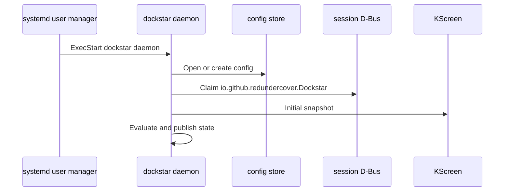
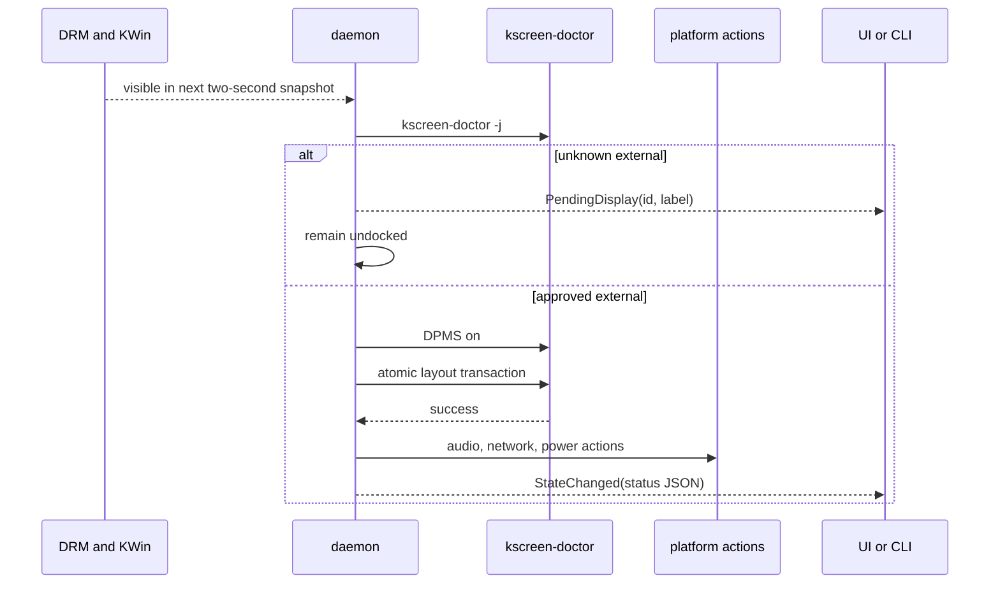

# Runtime Flow

## Startup

Invalid config stops startup before the D-Bus name is claimed. A fresh config
has no external approvals, so initial evaluation is non-disruptive.

## External hotplug

Approval changes clear the debounce signature. The next poll sees the external
as approved; Apply forces the same transition immediately.

## Resume

logind emits `PrepareForSleep(false)`. The daemon waits 750 ms, then performs a
forced evaluation. This lets the same path handle a dock connected during
suspend.

The system wake helper is earlier in the chain: firmware and a controller must
wake the CPU before logind can emit the resume signal.

## Undock

When a previously docked state has no approved external output:

1. Restore audio and power values remembered by the daemon.
2. Disconnect Ethernet only if Dockstar connected it.
3. Re-enable Wi-Fi only if Dockstar disabled it.
4. If the lid is closed and lock is enabled, lock the session.
5. If suspend is also enabled, request suspend after 500 ms.
6. Store and emit undocked state.

## Mirror path

Mirror bypasses `kscreen-doctor` application after using KScreen for discovery.
The backend opens its own Wayland connection, maps connectors to KDE output
objects, selects mode objects, sends one configuration, and waits for KWin's
applied or failed event.

## State consumers

- CLI reads state on demand over D-Bus.
- Tray reads state every five seconds.
- Settings reads state when opened and after Apply.
- `$XDG_RUNTIME_DIR/dockstar/state.json` mirrors the latest stored state for
  inspection; it is not an input to the daemon.
