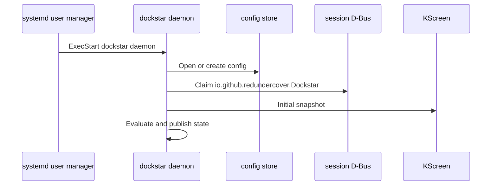
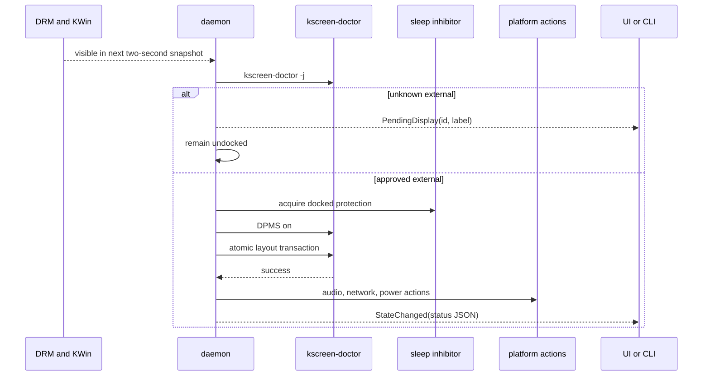

# Runtime Flow

## Startup

Invalid config stops startup before the D-Bus name is claimed. A fresh config
has no external approvals, so initial evaluation is non-disruptive.

## External hotplug

Approval changes clear the debounce signature. The next poll sees the external
as approved; Apply forces the same transition immediately.

## Resume

logind emits `PrepareForSleep(false)`. When user sleep protection is enabled,
the daemon immediately acquires a resume guard if the machine was docked or
lid-closed before sleep, or if hardware wake is enabled. It checks after 250
ms, every 500 ms for five seconds, and then every second for a maximum of 30
seconds. An approved display turns the guard into docked protection. An
open-lid undocked result releases early; otherwise the guard expires.

The system wake helper is earlier in the chain: firmware and a controller must
wake the CPU before logind can emit the resume signal.

## Undock

When a previously docked state has no approved external output:

1. Restore audio and power values remembered by the daemon.
2. Disconnect Ethernet only if Dockstar connected it.
3. Re-enable Wi-Fi only if Dockstar disabled it.
4. If the lid is closed and lock is enabled, lock the session.
5. If suspend is also enabled, release protection and request one intentional
   suspend after 500 ms.
6. Release sleep protection, except for the five-second closed-lid disconnect
   guard. If no Dockstar suspend is configured, desktop policy takes control
   when the guard expires.
7. Store and emit undocked state.

## Intentional suspend

The settings window, tray, and `dockstar suspend` call the daemon's
`SuspendNow` method. It marks the request pending, releases the logind lease,
and asks logind to suspend. A failed request reacquires protection immediately;
a request that never begins has a 15-second watchdog. Resume clears the bypass
and starts the normal bounded discovery guard when needed.

## Mirror path

Mirror bypasses `kscreen-doctor` application after using KScreen for discovery.
The backend opens its own Wayland connection, maps connectors to KDE output
objects, selects mode objects, sends one configuration, and waits for KWin's
applied or failed event.

## State consumers

- CLI reads state on demand over D-Bus.
- Tray reads state every five seconds.
- Settings reads state when opened and after Apply.
- `$XDG_RUNTIME_DIR/dockstar/state.json` mirrors the latest stored state for
  inspection; it is not an input to the daemon.
